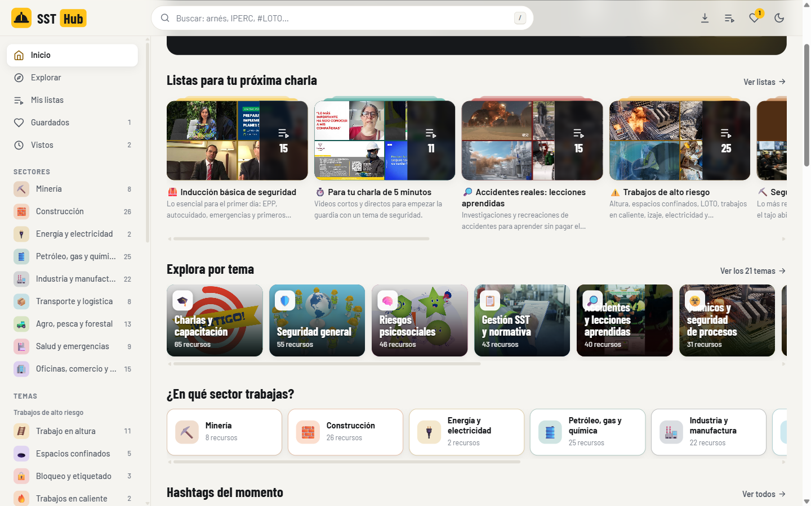
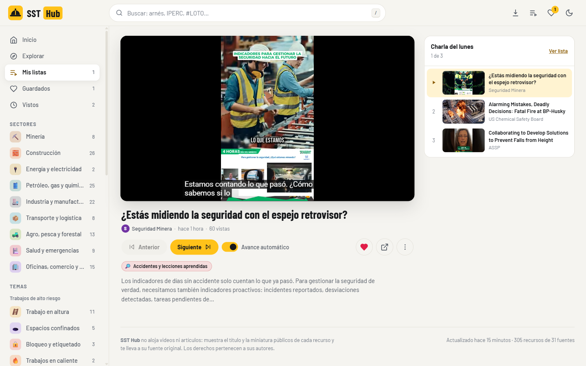
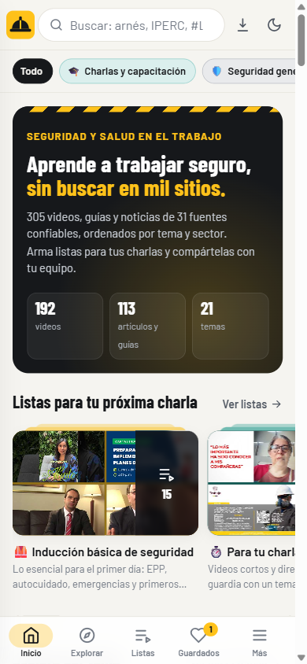
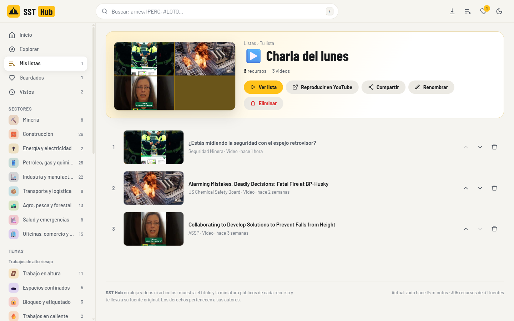
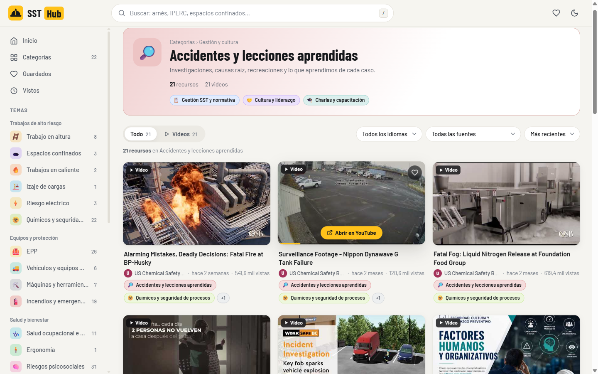
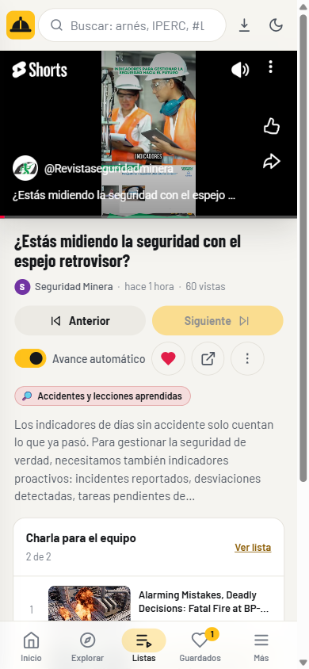

# SST Hub — Portal de seguridad laboral

Galería de miniaturas que reúne **6000 videos, artículos y guías** de seguridad y salud en el trabajo de **252 fuentes** (227 canales de YouTube y 25 blogs y revistas de Perú, Latinoamérica, España y el mundo), los **clasifica por tema, sector y hashtag** y, al hacer clic, **te lleva a la página original**. Además permite **armar listas para charlas** y verlas seguidas o compartirlas por WhatsApp. Funciona en computadora y como **app instalable en el celular**.

| Escritorio | Reproductor de listas | Celular |
|---|---|---|
|  |  |  |
|  |  |  |

## Qué puede hacer

**Encontrar contenido**
- **38 temas en 6 grupos**, pensados como los trabaja un área SSOMA:
  - *Riesgos críticos y alto riesgo*: riesgos y controles críticos, trabajos de alto riesgo (PETAR), altura, espacios confinados, LOTO, caliente, izaje, eléctrico, excavaciones, caída de rocas, explosivos y voladura, equipos móviles, máquinas, MATPEL y seguridad de procesos.
  - *Herramientas de gestión*: IPERC, ATS/PETS/permisos, inspecciones y OPT, normativa y sistema de gestión, indicadores.
  - *Investigación y aprendizaje*: investigación de incidentes, **métodos de investigación (ICAM, TapRooT, árbol de causas, 5 porqués, Ishikawa, SCAT)** y lecciones aprendidas.
  - *Emergencias*: respuesta ante emergencias, incendios y extintores, primeros auxilios.
  - *Salud y bienestar*: salud ocupacional (incluye mal de altura), higiene industrial, ergonomía, psicosocial, fatiga y somnolencia.
  - *Fundamentos y cultura*: conceptos básicos (peligro vs. riesgo, pirámide de Bird, jerarquía de controles), cultura y liderazgo, EPP, orden y señalización, resbalones y caídas, charlas y capacitación.
  - Los temas **paraguas** (*Riesgos críticos*, *Trabajos de alto riesgo*) muestran también todo lo de sus subtemas.
- **9 sectores**: Minería, Construcción, Energía, Petróleo/gas/química, Industria, Transporte, Agro y pesca, Salud y emergencias, Oficinas y servicios. Cada recurso dice **de qué riesgo trata** (tema) y **en qué industria aplica** (sector).
- **Hashtags automáticos** (#ICAM, #IPERC, #PETAR, #LOTO, #ControlesCríticos, #SaludMental…) más los que usan las propias fuentes (#SST, #SeguridadMinera).
- **Buscador preciso**: busca en título, descripción, hashtags y fuente. “IPERC” trae lo que menciona IPERC, no todo un tema; las siglas cortas (ATS, EPP, RCP, 5S) deben coincidir completas. Entiende sin tildes y en plural (“arneses” encuentra “arnés”). Si no hay coincidencias exactas, lo dice y ofrece el tema relacionado. Escribe `#` para buscar solo hashtags.
- **Recomendados para tu país, como YouTube**: primero lo que más se ve en tu país (se detecta solo y se puede cambiar), luego lo popular y reciente del resto, sin repetir la misma fuente seguida. Al bajar con el scroll van apareciendo más.
- Filtros por tipo (video, artículo, PDF), sector, idioma, fuente y orden (recomendados, recientes, **más vistos**…), en **cuadrícula o lista**.
- **Vista previa animada** al pasar el mouse sobre un video, como en los sitios de videos.
- Etiqueta **“Nuevo”** y aviso de “X recursos nuevos desde tu última visita”.

**Listas (playlists)**
- **Mis listas**: crea listas (“Charla del lunes”, “Inducción nuevos”) desde el botón ⋮ de cualquier recurso. Reordénalas, renómbralas o bórralas (con “Deshacer”).
- **Ver lista**: reproductor integrado con la cola al costado. Pasa solo al siguiente video (avance automático), con botones Anterior / Siguiente y atajos de teclado `N` y `P`.
- **Reproducir en YouTube**: abre todos los videos de la lista como una lista de YouTube.
- **Compartir**: por WhatsApp, con enlace (quien lo abre ve la lista y puede guardarla) o como texto con títulos y enlaces.
- **14 listas destacadas** que se arman solas en cada actualización: Inducción básica, Charla de 5 minutos, Lecciones aprendidas, ICAM y métodos de investigación, Riesgos críticos, Alto riesgo, Minería, Construcción, Salud mental, Emergencias, IPERC paso a paso, Conceptos básicos, Para supervisores y Recursos en inglés.

**Lo personal** (se guarda en el navegador, sin cuentas): ♥ Guardados, Vistos, Mis listas y “No me interesa” para ocultar recursos (con “Deshacer” y opción de restaurar).

**En el celular**: barra inferior tipo app (Inicio · Explorar · Listas · Guardados · Más), paneles que suben desde abajo para filtros y opciones (se cierran deslizando), reproductor a pantalla completa de ancho y **se puede instalar como app** (ícono propio, se abre sin barra del navegador y funciona sin conexión con lo último que cargó).

## Cómo funciona

```
 FUENTES                       RECOLECTOR (npm run recolectar)                    PÁGINA (public/)
 ───────                       ────────────────────────────────                   ────────────────
 227 canales de YouTube     ┐  1. Lee el RSS del canal y de hasta 10 de sus     Galería por tema y sector
   (y sus listas, por RSS)   │     listas de reproducción (gratis, sin clave)     Recomendados por país
 25 blogs y revistas (RSS)   ├► 2. Acumula todo en data/biblioteca.json  ──►     Hashtags y buscador
 YouTube API (opcional)      │  3. Clasifica: tema + sector + hashtags           Listas y reproductor
 Tus enlaces manuales        ┘  4. Descarta lo que no es de seguridad            Clic → fuente original
                                5. Arma las listas destacadas
                                6. Escribe public/data/contenido.js
```

**Cómo se llega a miles de videos sin clave:** el RSS de un canal solo trae sus últimos 15 videos, pero cada lista de reproducción del canal tiene su propio RSS con otros 15. El recolector lee primero las listas cuyo título habla de seguridad (se revisan cada 7 días, `data/listas-canales.json`). Además quita de las descripciones el texto que un canal repite en todos sus videos (“Suscríbete a nuestro canal de Seguridad y Salud…”) para que solo pase lo que de verdad trata de seguridad.

El portal no aloja nada: muestra título y miniatura públicos y enlaza a la fuente. El reproductor de listas usa el reproductor oficial de YouTube (embed).

## Qué necesitas

| | Qué | Estado / costo |
|---|---|---|
| ✅ | **Node.js 22 o superior** | Ya lo tienes (v24) |
| ✅ | Internet al actualizar | — |
| ⭐ Recomendado | **Clave de YouTube Data API v3**. Trae hasta **150 videos por canal**, la duración de cada video y búsquedas por tema | Gratis (10 000 unidades/día; una actualización completa usa ~2 500) |
| 🌐 Para publicarlo | Cuenta de **GitHub** (GitHub Pages) o **Vercel/Netlify** | Gratis |
| 🌐 Opcional | Dominio propio, por ejemplo `portalsst.pe` | ~US$ 12–30 al año |

## Uso diario

- **`ACTUALIZAR_PORTAL.bat`**: la primera vez instala lo necesario. Luego recolecta, clasifica y abre el portal.
- **`ABRIR_PORTAL.bat`**: abre el portal en `http://127.0.0.1:3012` sin actualizar. Deja abierta la ventana negra mientras lo uses. Si ya estaba abierto, solo abre el navegador.

> Tus listas, guardados y vistos quedan en el navegador **y en la dirección** desde la que abres el portal. Usa siempre `ABRIR_PORTAL.bat` (o siempre la misma dirección de internet) para encontrarlos. Abrir `public/index.html` con doble clic también funciona, pero ahí el reproductor integrado no puede mostrar videos (limitación de YouTube) y tendrá listas separadas.

Desde la terminal:

```bash
npm run recolectar                                   # actualizar contenido (2 a 4 minutos)
npm run reclasificar                                 # reclasificar sin internet (segundos), tras editar temas o palabras clave
npm run abrir                                        # abrir el portal (servidor local)
npm run agregar -- https://youtu.be/XXXX epp         # agregar un enlace a mano (sale como ★ Recomendado)
npm run agregar -- https://sitio.pe/guia.pdf         # también PDFs y artículos; el tema es opcional
npm run ocultar -- https://youtu.be/XXXX             # sacar algo del portal para siempre (para todos)
npm run categorias                                   # ver los ids de los temas
```

Después de agregar u ocultar, ejecuta `npm run recolectar` para que se refleje.

## Personalizar

| Quiero… | Edita |
|---|---|
| Agregar o quitar un canal de YouTube o un blog | `config/fuentes.json`. El canal acepta el ID `UC…` o el `@usuario`; el blog, la URL de su feed (en WordPress suele ser `https://sitio.com/feed/`). |
| Que una fuente que publica de todo solo deje pasar seguridad | En esa fuente: `"filtrar": true` |
| Que todo lo de una fuente vaya a un tema / sugerir un sector | En esa fuente: `"categoria": "epp"` / `"sector": "mineria"` |
| Descartar títulos con ciertas palabras | En la fuente: `"excluir": ["premios"]`, o `excluirGlobal` en `categorias.json` |
| Crear o ajustar temas y sectores (íconos, colores, palabras clave) | `config/categorias.json` |
| Crear o ajustar hashtags | `config/hashtags.json` |
| Crear o cambiar las listas destacadas | `config/listas.json` (reglas por tema, sector, hashtag, tipo e idioma; o enlaces fijos) |
| Cambiar el nombre “SST Hub”, textos o colores | `public/index.html`, `public/js/app.js` y las variables al inicio de `public/css/estilos.css` |

Al cambiar cualquier configuración, **toda la biblioteca se reclasifica** con `npm run reclasificar` (o en la siguiente recolección). Las instrucciones de cada archivo están dentro de él (campo `_ayuda`).

### Cómo clasifica

Cada tema y sector tiene palabras **fuertes** (3 puntos) y **débiles** (1 punto); en el título valen el triple. El tema con más puntos queda como principal y los demás que superan el umbral se agregan como etiquetas. En las fuentes con `"filtrar": true` solo entra lo que tenga al menos una palabra fuerte de un tema de seguridad: hablar de “minería” o de un “curso” no basta.

## Activar la clave de YouTube (recomendado)

1. Entra a <https://console.cloud.google.com/>, crea un proyecto y activa **YouTube Data API v3**.
2. En *Credenciales* crea una **clave de API** y restríngela a esa API.
3. Copia `.env.ejemplo` como `.env` y pega la clave: `YT_API_KEY=AIza…`
4. Ejecuta `ACTUALIZAR_PORTAL.bat`. La biblioteca pasará de cientos a miles de recursos.

El archivo `.env` no se sube a GitHub (está en `.gitignore`).

## Publicarlo en internet con actualización diaria automática

1. Crea un repositorio en GitHub y sube **esta carpeta** (`PORTAL_SST`) como raíz.
2. En el repositorio: *Settings → Pages → Source*: **GitHub Actions**.
3. Opcional: *Settings → Secrets and variables → Actions* → secreto `YT_API_KEY`.
4. Listo: `.github/workflows/actualizar.yml` recolecta todos los días a las 6:00 a. m. (hora de Perú) y publica en `https://<tu-usuario>.github.io/<repositorio>/`. Desde ahí cualquiera puede **instalarlo en el celular** (Chrome: menú › *Instalar app*; iPhone: Compartir › *Agregar a inicio*) y los enlaces de listas compartidas funcionan para todos.

> **Si el proyecto está en una subcarpeta** (por ejemplo `pruebas/ssthub/`): GitHub solo ejecuta los workflows que están en `.github/workflows/` de la **raíz** del repositorio. Para activarlo, copia `actualizar.yml` a la raíz, agrega `defaults: { run: { working-directory: ssthub } }` al trabajo y cambia `path: public` por `path: ssthub/public` (y las rutas de `git add`). Ojo: GitHub Pages publica un solo sitio por repositorio.

## Estructura

```
PORTAL_SST/
├── ACTUALIZAR_PORTAL.bat / ABRIR_PORTAL.bat
├── config/
│   ├── fuentes.json        canales, blogs y búsquedas
│   ├── categorias.json     temas, sectores y palabras clave
│   ├── hashtags.json       hashtags automáticos
│   ├── listas.json         listas destacadas
│   └── curaduria.json      enlaces agregados u ocultos a mano
├── scripts/
│   ├── recolectar.mjs      el recolector
│   ├── servidor.mjs        servidor local (http://127.0.0.1:3012)
│   ├── curar.mjs           atajos agregar / ocultar / categorias
│   └── lib/                lectores, clasificador, hashtags y utilidades
├── data/biblioteca.json    todo lo recolectado (se acumula; no borrar)
├── public/                 el sitio que se publica
│   ├── index.html, css/, js/, favicon.svg
│   ├── manifest.webmanifest, sw.js, iconos/   (app instalable)
│   └── data/contenido.js   generado por el recolector
└── .github/workflows/actualizar.yml
```

## Buenas prácticas y aspectos legales

- **Solo enlazar, nunca copiar.** El portal muestra título, miniatura y un resumen corto, y siempre lleva a la fuente. Así funcionan Google News y los agregadores.
- **Fuentes pensadas para compartirse:** los feeds RSS y las imágenes `og:image` existen para eso. Los videos se ven con el reproductor oficial de YouTube y respetan la opción del autor (si no permite insertarlo, el portal ofrece abrirlo en YouTube).
- **Cita la fuente en cada tarjeta** (ya lo hace) y atiende cualquier pedido de retiro con `npm run ocultar`.

## Ideas para una siguiente fase

- **Cuentas y listas en la nube** (Supabase o Firebase) para ver tus listas en todos tus dispositivos y para un contador global de “Lo más visto del mes”.
- **Clasificación con IA** para los casos dudosos y para un nivel por recurso (trabajador, supervisor, especialista).
- **Modo charla**: pantalla completa con un código QR por recurso para que la cuadrilla lo abra en su celular, y registro de asistencia.
- Formulario **“Sugerir un recurso”** con aprobación del administrador.
